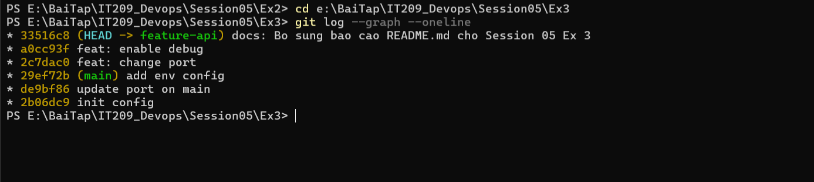

# Báo Cáo Bài Tập 3 (Session 05): Xử Lý Xung Đột Phức Tạp Trong Quá Trình Rebase

- **Khóa học:** IT209 - DevOps
- **Họ và tên:** Nguyễn Tiến Thành
- **Mã số sinh viên (MSSV):** B24DTCN283
- **Email:** thenngk6@gmail.com
- **GitHub Username:** ThanhDZsudo
- **Đường dẫn nộp bài dự kiến:** `homework/session_05/ex3/`

---

## 1. Mục Tiêu Bài Tập
- Hiểu rõ sự khác biệt căn bản giữa cơ chế giải quyết xung đột khi **Merge** và khi **Rebase**.
- Thực hành thành thạo quy trình giải quyết xung đột từng bước (**Step-by-step conflict resolution**) trong Rebase bằng `git rebase --continue`.
- Tái cấu trúc lịch sử commit của nhánh tính năng đưa lên trên đỉnh nhánh chính một cách thẳng hàng (**Linear History**), không tạo commit gộp (merge commit) trung gian.

---

## 2. Bối Cảnh & Các Bước Thực Hiện Chi Tiết

### Bước 1: Khởi tạo commit gốc trên nhánh `main`
Tạo tệp `config.json` ban đầu và commit:
```json
{
  "port": 8080,
  "debug": false
}
```
```bash
git init
git config --local user.name "Nguyễn Tiến Thành"
git config --local user.email "thenngk6@gmail.com"
git branch -M main
git add config.json
git commit -m "init config"
```

---

### Bước 2: Tạo nhánh `feature-api` và thực hiện 2 commit
Tạo nhánh mới để phát triển tính năng:
```bash
git checkout -b feature-api
```
1. Sửa `"port": 9000` và commit lần 1:
   ```bash
   git commit -am "feat: change port"
   ```
2. Sửa tiếp `"debug": true` và commit lần 2:
   ```bash
   git commit -am "feat: enable debug"
   ```

---

### Bước 3: Nhánh `main` cập nhật song song 2 commit mới
Quay về nhánh `main`:
```bash
git checkout main
```
1. Nhánh `main` sửa `"port": 8081` và commit:
   ```bash
   git commit -am "update port on main"
   ```
2. Nhánh `main` bổ sung thêm `"env": "production"` và commit:
   ```bash
   git commit -am "add env config"
   ```

**Đồ thị lịch sử trước khi Rebase (`git log --graph --oneline --all`):**
```text
* 29ef72b (HEAD -> main) add env config
* de9bf86 update port on main
| * 13180de (feature-api) feat: enable debug
| * 50fcf5c feat: change port
|/  
* 2b06dc9 init config
```
> **Nhận xét:** Hai nhánh đã rẽ nhánh độc lập từ commit gốc `2b06dc9`, và cả 2 nhánh cùng sửa đổi các dòng cấu hình trong tệp `config.json`.

---

### Bước 4: Kích hoạt Rebase nhánh `feature-api` lên `main`
Chuyển sang nhánh `feature-api` và thực hiện rebase:
```bash
git checkout feature-api
git rebase main
```

---

### Bước 5: Xử lý xung đột Chặng 1 (Commit `feat: change port`)

Khi Git áp dụng commit đầu tiên `50fcf5c (feat: change port)` lên đỉnh nhánh `main`, xung đột xuất hiện do cả hai nhánh đều sửa đổi trường `port`:
```text
Auto-merging config.json
CONFLICT (content): Merge conflict in config.json
error: could not apply 50fcf5c... feat: change port
```

**Nội dung xung đột trong tệp `config.json`:**
```json
{
<<<<<<< HEAD
  "port": 8081,
  "debug": false,
  "env": "production"
=======
  "port": 9000,
  "debug": false
>>>>>>> 50fcf5c (feat: change port)
}
```

**Cách giải quyết thủ công Chặng 1:**
- Chọn giá trị `"port": 9000` của nhánh tính năng `feature-api`.
- Bảo toàn cấu hình `"env": "production"` của nhánh chính `main`.
- Xóa bỏ hoàn toàn các ký hiệu xung đột:
```json
{
  "port": 9000,
  "debug": false,
  "env": "production"
}
```

**Tiếp tục tiến trình Rebase:**
```bash
git add config.json
git rebase --continue
```

---

### Bước 6: Xử lý xung đột Chặng 2 (Commit `feat: enable debug`)

Git tiếp tục chuyển sang commit thứ hai `13180de (feat: enable debug)` và lại phát sinh xung đột:
```text
Auto-merging config.json
CONFLICT (content): Merge conflict in config.json
error: could not apply 13180de... feat: enable debug
```

**Nội dung xung đột trong tệp `config.json`:**
```json
{
  "port": 9000,
<<<<<<< HEAD
  "debug": false,
  "env": "production"
=======
  "debug": true
>>>>>>> 13180de (feat: enable debug)
}
```

**Cách giải quyết thủ công Chặng 2:**
- Giữ `"debug": true` theo yêu cầu của commit tính năng.
- Bảo toàn `"env": "production"` của nhánh chính.
- Xóa bỏ ký hiệu xung đột:
```json
{
  "port": 9000,
  "debug": true,
  "env": "production"
}
```

**Hoàn tất Rebase:**
```bash
git add config.json
git rebase --continue
```
**Kết quả hiển thị từ Git:**
```text
[detached HEAD a0cc93f] feat: enable debug
 1 file changed, 1 insertion(+), 1 deletion(-)
Successfully rebased and updated refs/heads/feature-api.
```

---

## 3. Kết Quả Kiểm Tra Và Bằng Chứng Thực Thi (Verification)

### 3.1. Kiểm tra trạng thái làm việc (`git status`)
```bash
git status
```
**Output:**
```text
On branch feature-api
nothing to commit, working tree clean
```
*(Tiến trình rebase đã hoàn tất 100%, không còn xung đột tồn đọng).*

---

### 3.2. Lịch sử commit sau khi hoàn thành (`git log --graph --oneline`)
```bash
git log --graph --oneline
```
**Output thực tế:**
```text
* a0cc93f (HEAD -> feature-api) feat: enable debug
* 2c7dac0 feat: change port
* 29ef72b (main) add env config
* de9bf86 update port on main
* 2b06dc9 init config
```
> **Đánh giá kết quả:** Lịch sử hoàn toàn thẳng hàng (Linear), không hề có merge commit phụ. Hai commit của `feature-api` đã được đặt nối tiếp ngay sau các commit mới nhất của `main`.

---

### 3.3. Nội dung tệp `config.json` hoàn chỉnh cuối cùng
```json
{
  "port": 9000,
  "debug": true,
  "env": "production"
}
```

---

### 3.4. Hình ảnh chụp màn hình minh chứng đồ thị nhánh:


---

## 4. Phân Tích So Sánh: Giải Quyết Xung Đột Khi Merge vs Khi Rebase

| Tiêu chí | Giải quyết xung đột khi Merge | Giải quyết xung đột khi Rebase |
| :--- | :--- | :--- |
| **Bản chất hoạt động** | Tạo ra một **Merge Commit** mới kết nối 2 nhánh. | Áp dụng lần lượt từng commit của nhánh tính năng lên đỉnh nhánh đích (**Re-play commits**). |
| **Số lần xử lý xung đột** | **Chỉ 1 lần duy nhất** cho toàn bộ quá trình gộp nhánh. | **Từng bước (Step-by-step)**: Có thể xung đột nhiều lần tương ứng với từng commit được áp dụng lại. |
| **Hình thái đồ thị lịch sử** | Phân nhánh và gộp lại dạng mạng lưới (Non-linear), lưu giữ nguyên vẹn ngữ cảnh lịch sử. | Thẳng tắp (Linear), lịch sử commit gọn gàng, sạch sẽ như thể các tính năng được phát triển tuần tự. |
| **Tính an toàn** | An toàn, không thay đổi mã hash của các commit đã có. | Viết lại lịch sử (Rewrite commit history, thay đổi SHA-1 hash). |
| **Quy tắc áp dụng DevOps** | Thích hợp cho việc tích hợp vào các nhánh dùng chung (`main`, `release`). | Thích hợp cho việc cập nhật code mới nhất từ `main` vào nhánh cá nhân trước khi tạo Pull Request. |